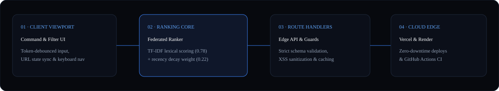

<div align="center">
  
</div>

<br />

<div align="center">
  <a href="https://github.com/santoshkumarvvv/search-hub-/actions">
    
  </a>
  &nbsp;
  <a href="https://github.com/santoshkumarvvv/search-hub-/actions/workflows/codeql.yml">
    
  </a>
  &nbsp;
  <a href="https://nextjs.org">
    
  </a>
  &nbsp;
  <a href="./LICENSE">
    
  </a>
</div>

---

### 01 · System Architecture & Data Pipeline

<div align="center">
  
</div>

**Search Hub (`search-hub-`)** is a high-velocity federated search router and software package discovery platform engineered with **Next.js 15 (App Router)**, **React 19**, and **Strict TypeScript**. It unifies client-side worker sharding with serverless edge API endpoints secured by `scrypt:v1` cryptographic key derivation.

---

### 02 · Engineering Benchmarks & Security Posture

| Capability / Metric | Specification | Architectural Mechanism |
| :--- | :--- | :--- |
| **App Version** | **`2.4.0`** | Single source of truth defined in `lib/version.ts`, synced across `package.json`, `/api/status`, and telemetry. |
| **Cryptographic Vault** | **`scrypt:v1`** | Salted KDF ($N=16384, r=8, p=1$, keylen=64) with `crypto.timingSafeEqual` and legacy SHA-256 auto-migration. |
| **Worker Isolation** | **`Trusted Origin Guard`** | `public/workers/searchWorker.js` validates `e.origin` against strict domain allow-lists before query execution. |
| **Ranking Formula** | **`0.78 Lexical / 0.22 Recency`** | Deterministic composite ranking with multi-token intersection boosts (`lib/federatedRanker.ts`). |
| **Full-Text Index** | **`Okapi BM25`** | Robertson-Spärck Jones BM25 with Damerau-Levenshtein fuzzy typo tolerance (`lib/search/bm25.ts`). |
| **SaaS Rate Limiter** | **`Sliding Window`** | Tiered quotas (`free`, `pro`, `enterprise`) with sliding 60-second window rate limiting and actionable hints. |

---

### 03 · Repository Architecture

```text
search-hub-/
├── .github/workflows/        # Automated CI & CodeQL verification pipelines
├── assets/                   # Vector SVG hero banner & architecture topology diagrams
├── app/
│   ├── api/
│   │   ├── status/           # Edge runtime health & engine telemetry (/api/status)
│   │   └── v1/
│   │       ├── keys/         # Cryptographic key minting with scrypt:v1 (/api/v1/keys)
│   │       └── radar/        # Authenticated rate-limited intelligence feed (/api/v1/radar)
│   ├── layout.tsx            # Root layout with dark-first typography & metadata
│   ├── page.tsx              # Server-rendered catalog & federated search entry
│   └── globals.css           # Tailwind CSS utility layer
├── components/
│   ├── Browser.tsx           # Interactive search controller, category filters & URL sync
│   └── Card.tsx              # Package/application card with resilient fallback states
├── lib/
│   ├── version.ts            # Canonical single source of truth version constant (2.4.0)
│   ├── federatedRanker.ts    # Deterministic lexical (0.78) + recency (0.22) ranking engine
│   ├── search/bm25.ts        # Okapi BM25 full-text inverted index with typo tolerance
│   ├── saas/
│   │   ├── apiKeyGateway.ts  # scrypt:v1 key vault, rate limiter & legacy migration
│   │   └── techRadarEngine.ts# Multi-category technology velocity indicators
│   └── types.ts              # Strict TypeScript domain contracts
├── public/
│   └── workers/
│       └── searchWorker.js   # Hardened Web Worker with trusted origin allow-list
├── test/
│   └── bm25.test.mjs         # Deterministic unit test matrix for BM25 and Federated Ranker
└── tsconfig.json             # Strict TypeScript compiler configuration
```

---

### 04 · Deterministic Test Suite

Run unit tests directly via Node.js built-in test runner:

```bash
npm test
# Executes: node --test test/*.test.mjs
```

Static type check and build verification:

```bash
npm run lint
npm run build
```

---

### License

Released under the [MIT License](./LICENSE) · Engineered by **[Santosh Kumar (@santoshkumarvvv)](https://github.com/santoshkumarvvv)**.
